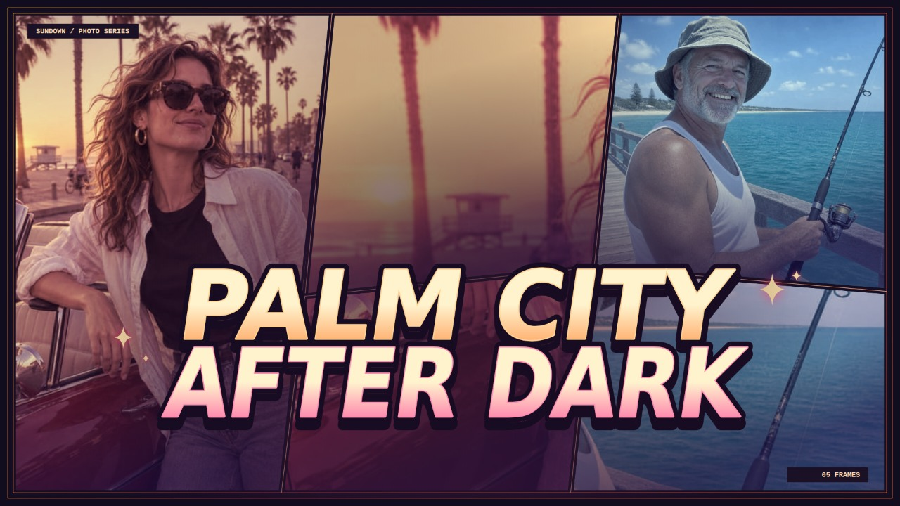

# Sundown Studio

Sundown Studio turns your photos into a sunset or neon collage with angled panels and big poster lettering. Run `node serve.ts` with Node.js 22.18+ and open `http://localhost:8080` in desktop Chrome.

1. Add one or more photos, or choose **Load samples**. A single photo fills every panel.
2. Click a panel and drag to reframe it. Use the zoom slider or choose another photo from the library for that panel.
3. Edit the caption, choose your color grade and canvas size, and select **Export PNG**.

Photos are processed locally in the browser. The static app uses system fonts and requires no build step or internet connection. The two bundled sample photos came with the make.fun kit and are free to use.

